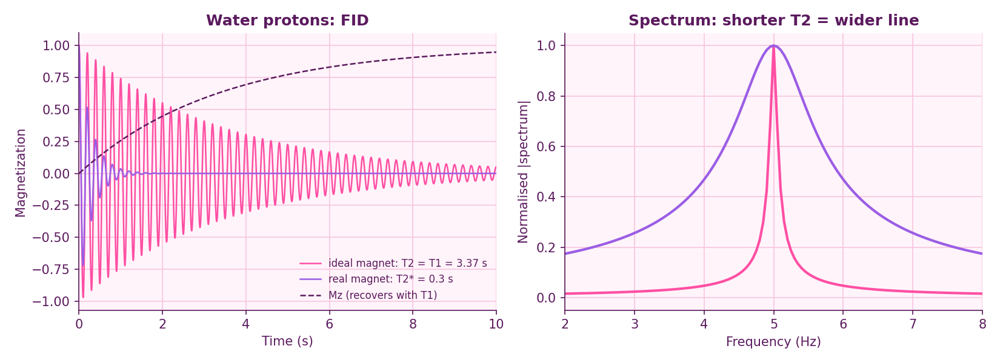
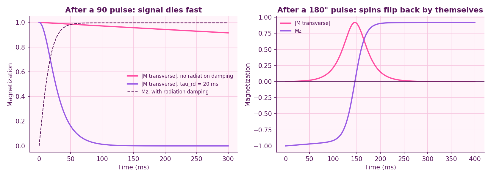
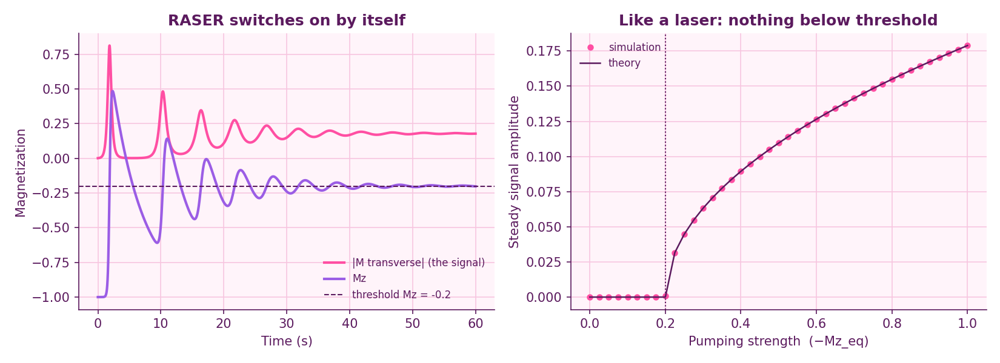
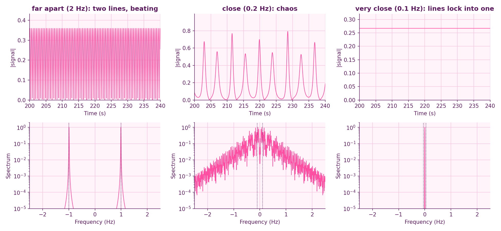
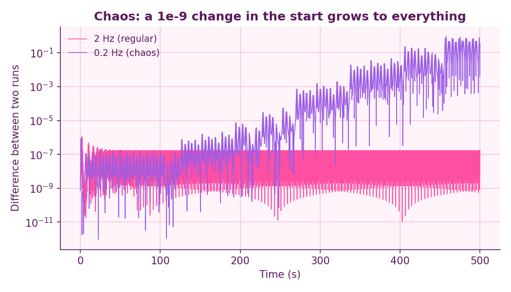
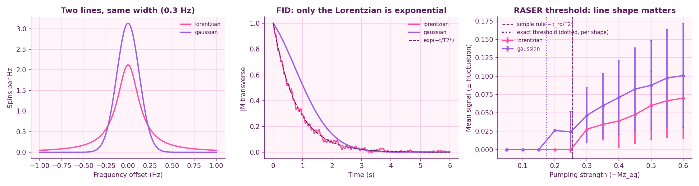
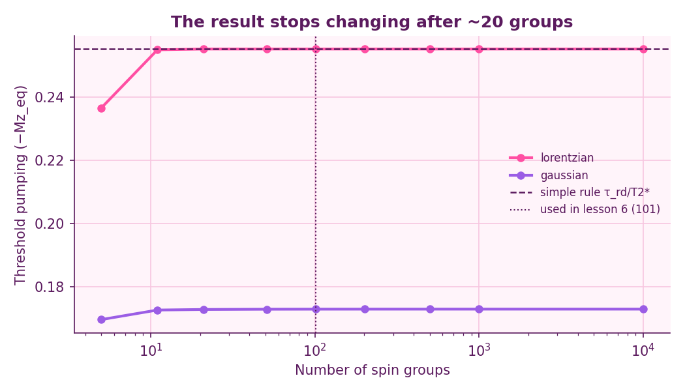

# Simulating an NMR RASER

A RASER (radio-frequency amplification by stimulated emission of radiation) is the NMR
analogue of a laser. Parahydrogen keeps nuclear spins inverted, the NMR coil feeds their
signal back to them, and above a threshold the sample starts to oscillate by itself, with
no RF pulse. This project builds a RASER model step by step from the Bloch equations and
shows its threshold, its laser-like start-up, the chaos and synchronisation that appear
when two spectral lines share one coil, and how the shape of an inhomogeneous line changes
the threshold.

## Model

Bloch equations in the rotating frame, with radiation damping (the coil acting back on the
sample, coupling time τ_rd) and pumping (Mz relaxes towards Mz_eq, which parahydrogen makes
negative):

```
dMx/dt = −δ·My − Mx/T2 − k·Mz·Sx
dMy/dt =  δ·Mx − My/T2 − k·Mz·Sy
dMz/dt = (Mz_eq − Mz)/T1 + k·(Mx·Sx + My·Sy),      k = 1/(M0·τ_rd)
```

For one line, (Sx, Sy) = (Mx, My). For several lines, (Sx, Sy) is the total transverse
magnetization: all lines feel the same coil field, which couples them.

## 1. Free precession: water protons

Degassed water at 25 °C: T1 = 3.37 s (measured by Simpson & Carr), and T2 = T1 assumed
because water tumbles fast (extreme narrowing). In a real magnet the field is not uniform, so
the signal decays with a shorter T2* (here 0.3 s as an example) and the line is 11× wider:
0.094 Hz vs 1.06 Hz.



## 2. Radiation damping

With a sensitive probe the coil turns the magnetization back towards +z within tens of
milliseconds (τ_rd = 20 ms), much faster than T2. If the spins start inverted, a tiny
tilt of 0.1° is amplified: the signal bursts out after 146 ms (simple theory: 141 ms) and
the spins flip back by themselves. This is the seed of the RASER.



## 3. RASER: threshold and steady oscillation

With continuous pumping the burst does not die out. After a few relaxation oscillations,
as in a laser, the system settles into a steady oscillation.

- The RASER starts only if pumping beats the losses: Mz_eq < −τ_rd/T2* (−0.2 here).
- Above threshold Mz is clamped exactly at the threshold value, and all extra pumping goes
  into the signal, whose amplitude grows as √(pumping − threshold).

Simulation and analytic theory agree across the whole range.



## 4. Two lines, one coil: beating, chaos, locking

Two lines pumped equally; only their separation changes.

| Separation | Behaviour |
|---|---|
| 2 Hz | two sharp lines, regular beating |
| 0.2 Hz | chaos: irregular bursts, broad spectrum |
| 0.1 Hz | frequency locking: both lines oscillate at one frequency |



Chaos test: two runs that differ by 10⁻⁹ at the start. In the regular case the difference
stays tiny; in the chaotic case it grows exponentially until the runs are unrelated.



## 5. Field inhomogeneity: the T2* rule is not always right

A real magnet is not uniform, so the sample is split into 101 spin groups with slightly
different frequencies (intrinsic T2 = 3 s each), all sharing one coil. Two line shapes with
the same width (FWHM = 0.3 Hz, so the same T2* = 0.78 s from the linewidth):

| Line shape | Threshold from the rule −τ_rd/T2* | Exact threshold |
|---|---|---|
| Lorentzian | −0.255 | −0.255 |
| Gaussian | −0.255 | −0.173 |

For a Gaussian line the RASER starts with about one third less pumping than the T2* rule
predicts. The threshold is set by how many spins sit near the centre of the line, not by the
linewidth: linearising the equations gives the condition
1 = −Mz_eq/τ_rd · ⟨(1/T2) / ((1/T2)² + δ²)⟩, which is dominated by small δ. Above threshold
the signal fluctuates strongly, because different spin groups compete for the coil.



**Convergence check.** The threshold does not depend on the number of spin groups once there
are about 20 or more (101 were used):

| Groups | Lorentzian | Gaussian |
|---|---|---|
| 11 | −0.2549 | −0.1727 |
| 21 | −0.2552 | −0.1729 |
| 101 | −0.2552 | −0.1730 |
| 10001 | −0.2552 | −0.1730 |



## Tests

`pytest` checks the code against exact results: free precession, the analytic
radiation-damping solution (Mx = sech(t/τ_rd), Mz = tanh(t/τ_rd)), the RASER steady state,
that the multi-line model reduces to the single-line one, and that the exact threshold equals
the T2* rule for a Lorentzian line.

## Limitations and next steps

- Parameters in sections 3–5 are illustrative, not fitted to an experiment.
- In sections 3–4, T2 stands for an effective T2*, and T1 lumps relaxation and pumping together.
- No noise: in a real RASER thermal noise starts the oscillation and limits the linewidth.
- Next: J-coupled multiplets, coil detuning, more lines, and comparison with measured
  RASER signals.

## How to run

```bash
pip install -r requirements.txt
python scripts/free_precession.py      # 1. free precession of water protons
python scripts/radiation_damping.py    # 2. radiation damping
python scripts/raser.py                # 3. RASER threshold and steady state
python scripts/two_lines.py            # 4. two lines: beating, chaos, locking
python scripts/inhomogenity.py         # 5. field inhomogeneity and the threshold
python scripts/convergence.py          # 5. convergence in the number of spin groups
pytest
```

## Structure

```
src/bloch.py      Bloch equations with radiation damping and pumping (one line)
src/raser2.py     RASER with many spin groups sharing one coil, line shapes, threshold
src/style.py      pink-and-purple plot style
scripts/          one script per section, each saves its figure to figures/
tests/            checks against exact solutions
```

## References

- F. Bloch, *Nuclear induction*, Physical Review 70, 460 (1946).
- N. Bloembergen, R. V. Pound, *Radiation damping in magnetic resonance experiments*,
  Physical Review 95, 8 (1954).
- J. R. Simpson, H. Y. Carr, *Diffusion and nuclear spin relaxation in water*,
  Physical Review 111, 1201 (1958).
- M. Suefke, S. Lehmkuhl, A. Liebisch, B. Blümich, S. Appelt, *Para-hydrogen raser
  delivers sub-millihertz resolution in nuclear magnetic resonance*, Nature Physics 13,
  568 (2017).
